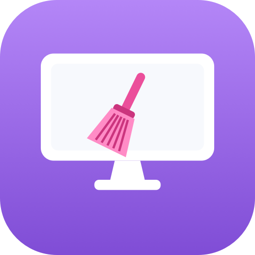

# mac_cleaner

<p align="center">
  
</p>

A from-scratch, all-Swift re-implementation of a CleanMyMac-style macOS utility,
reverse-engineered from CleanMyMac 5 (v5.0.5) for study. No MacPaw code is used.

The icon (`icon.png`) is generated by `Scripts/make-icon.swift`.

## Quick start

```sh
Scripts/make-app.sh && open build/MacCleaner.app          # main window
Scripts/make-menu-app.sh && open build/MacCleanerMenu.app # menu-bar health addon
```

`make-app.sh` builds + ad-hoc signs the main app (no Apple Developer account
needed) and generates its icon. `make-menu-app.sh` does the same for the
menu-bar addon, an `LSUIElement` agent that puts a gauge icon in your top-right
menu bar — click it for live RAM / CPU / temperature. To keep it running at
login, add it in System Settings > General > Login Items. Re-run either script
after a change to rebuild and relaunch.

## App icon

The icon is drawn entirely in code by `Scripts/make-icon.swift` — a purple
gradient background, a centered white monitor, and a pink broom across the screen
(all `NSBezierPath`; there's no broom in SF Symbols). It renders every size into
an `.iconset` and runs `iconutil` to produce a multi-resolution `.icns`, plus a
`…preview.png` so you can eyeball the result.

```sh
# Generate the .icns (writes build/AppIcon.icns + build/AppIcon.preview.png)
swift Scripts/make-icon.swift build/AppIcon.icns

# Refresh the README image after a restyle
cp build/AppIcon.preview.png icon.png
```

`make-app.sh` calls this automatically when `build/AppIcon.icns` is missing, so
deleting that file regenerates the icon on the next build. To restyle, edit the
colors/shapes at the top of `drawIcon` / `drawBroom` in the script.

## Running locally without the Apple Developer Program ($99/yr) — yes

You do **not** need the paid Apple Developer Program to build and run this on
your own Mac. The $99/yr program only buys **notarization** (so *other people's*
Macs run it without Gatekeeper warnings) and a stable **Developer ID Team ID**
(which `SMAppService` needs). For personal/local use, none of that applies.

Three cost-free ways to run it, easiest first:

1. **Straight from SwiftPM — nothing to sign:**
   ```sh
   swift run MacCleanerApp        # the main window (6-module sidebar)
   swift run MacCleanerMenu       # the menu-bar health addon
   swift run MacCleanerUninstall --app "Chrome"   # uninstaller CLI (dry run)
   ```

2. **A real, double-clickable app — ad-hoc signed (free):**
   ```sh
   Scripts/make-app.sh            # builds build/MacCleaner.app, codesign -s -
   open build/MacCleaner.app
   ```
   Ad-hoc signing (`codesign -s -`) costs nothing and has no expiry. A locally
   built app is **not** quarantined, so it opens with no Gatekeeper prompt
   (verified: `codesign -v` → "satisfies its Designated Requirement"). It just
   can't be handed to someone else without them right-click-opening it — that's
   the only thing you lose by not paying.

3. **The root helper — local sudo install (free):**
   `SMAppService` is the one piece that genuinely wants paid Developer ID
   signing, because it validates the code-signing requirement between app and
   daemon. For local-only use we skip `SMAppService` and install the helper as a
   plain root LaunchDaemon instead:
   ```sh
   sudo Scripts/install-helper-local.sh      # root LaunchDaemon, pin relaxed
   sudo Scripts/uninstall-helper-local.sh    # undo
   ```
   Because an ad-hoc signature has no Team ID to pin, the helper runs with the
   code-signing requirement **disabled** in this mode (`--local`); access is
   gated only by it being root-installed. Fine for yourself — do not ship this
   configuration to others.

**Alternative:** a *free* Apple ID "Personal Team" in Xcode gives a development
signing certificate (still $0). Its 7-day provisioning expiry affects iOS
devices, not local macOS apps, so it's an option but ad-hoc is simpler here.

**If you ever do want to distribute it:** pay the $99, set `IPC.teamIdentifier`,
use `Scripts/install-helper.sh` + `SMAppService`, and notarize the app.

## Planned targets
```
MacCleanerApp         main window — all 6 modules functional (Smart Care,
                      Cleanup, Protection, Performance, Applications,
                      My Clutter) + Overview                              [built]
MacCleanerHelper      root privileged daemon + XPC for destructive removals [built]
MacCleanerMenu        menu-bar health addon (RAM / CPU / temperature)   [built]
MacCleanerUninstall   deep-clean uninstaller CLI                        [built]
```

## Feature → engine map (from RE of CleanMyMac 5)
| Feature       | CMM module            | Engines                                             |
|---------------|-----------------------|-----------------------------------------------------|
| Smart Care    | SmartCareModule       | orchestrates Cleanup + Protection + Performance     |
| Cleanup       | JunkCleanupModule     | SystemJunk / Trash / Mail junk scanners             |
| Protection    | ProtectionModule      | Malware (Moonlock) + Privacy                        |
| Performance   | PerformanceModule     | login items, launch agents, maintenance, RAM        |
| Applications  | ApplicationsModule    | Uninstaller (deep-clean leftovers) + Updater        |
| My Clutter    | OrganizeModule        | Large & Old files, Duplicates, media junk           |

All destructive ops in CMM route: app → XPC (credential + rule check) → root
Agent (`PrivilegedFileRemover` / `PrivilegedOperationsPerformerService`).

## This slice: the menu-bar health addon
`MacCleaner Menu` is an accessory app (no Dock icon, like CMM's
`CleanMyMac_5_Menu` with `LSUIElement = true`). It shows live **RAM**, **CPU**,
and **temperature**, polled every 2s by `SystemMonitor` (mirrors CMM's
`PeriodicMonitor`).

Data sources, matching how CMM's HealthMonitor sources them:
- **RAM** — Mach `host_statistics64` (public). 1:1 with CleanMyMac.
- **CPU** — Mach `host_statistics` HOST_CPU_LOAD_INFO tick deltas (public).
- **CPU temperature** — private IOHID thermal sensors (`CSensors` C shim); no
  official public API on Apple Silicon, no entitlement needed. May be `nil` on
  some configs.
- **Battery temperature** — IOKit `AppleSmartBattery` (public).
- **Thermal state** — `ProcessInfo.thermalState`, the always-available fallback.

### Build & run
```sh
swift build
swift run MacCleanerMenu     # look for the gauge icon in the top-right menu bar
```

## Second slice: the Uninstaller deep-clean
`MacCleanerUninstall` reconstructs CleanMyMac's `LeftoversFetcher`. It keys off
an app's **name** and **bundle id**, then expands the fixed set of `~/Library`
and `/Library` locations (Application Support, Caches, Preferences, Logs,
HTTPStorages, WebKit, Saved Application State, Cookies, Application Scripts,
Containers), **verifies sandbox + group containers by reading each container's
`.com.apple.containermanagerd.metadata.plist`** (so it catches group containers
whose folder name doesn't start with the bundle id), and matches
LaunchAgents/LaunchDaemons by plist `Label`/`Program`.

```sh
swift run MacCleanerUninstall                     # list installed apps
swift run MacCleanerUninstall --app "Postman"     # dry-run deep-clean scan (nothing deleted)
swift run MacCleanerUninstall --app "Postman" --trash   # move leftovers to Trash (reversible)
```
Dry-run is the default. `--trash` uses `FileManager.trashItem` (reversible);
system-owned files are flagged as needing the root helper rather than
force-deleted. Add `--use-helper` to route those through the privileged helper
(once installed).

## Overview dashboard
The Overview tab shows live system health, refreshed every 2s by `SystemMonitor`:
Memory, CPU, **Storage** (used/total of the boot volume), **Wi-Fi** (connected
state + live ↓/↑ throughput from interface byte-counter deltas), **Battery**
(percent + charging / fully-charged / on-battery via IOKit Power Sources), **CPU
& battery temperature**, and **Connected Devices** (external volumes + connected
Bluetooth peripherals).

Note: the Wi-Fi **network name** (SSID) is gated behind Location Services on
modern macOS — without that permission it shows "Connected" instead of the name;
throughput and connected/not-connected work regardless.

## Cleanup module (System Junk)
`CleanupScanner` (JunkCleanupModule) scans the standard user-domain junk roots —
User Caches, User Logs, Saved Application State, Trash, and Xcode Derived
Data/Archives/Device Support — listing each root's children with sizes so you can
deselect individual entries. Cache/log/derived-data categories are pre-ticked
(`JunkCategory.autoSelect`, mirroring CleanMyMac's `JunkCleanupAutoSelectableStrategy`);
Saved Application State is left for you to opt into. Cleaning moves to Trash
(reversible), reusing `FileRemover`.

```sh
swift run MacCleanerUninstall --scan-junk     # read-only verification
# or the Cleanup tab in MacCleanerApp
```

## My Clutter module (Large & Old + Duplicates)
`OrganizeScanner` (OrganizeModule) does one walk of the home document folders
(Downloads, Documents, Desktop, Movies — Full Disk Access needed for the full
set) and derives two analyses:
- **Large & Old Files** — files ≥100 MB, or ≥10 MB and unused for ≥1 year (by
  the later of access/modification date).
- **Duplicates** — exact byte-for-byte copies, found by grouping on size then
  streaming SHA-256 only within same-size groups (the deterministic core of
  CleanMyMac's "Gemini Duplicates"). Each group keeps the shortest-path copy and
  marks the rest removable. (Perceptual "similar images" is future work.)

```sh
swift run MacCleanerUninstall --scan-clutter [--root ~/some/dir]   # read-only
# or the My Clutter tab in MacCleanerApp
```
Verified on a controlled fixture: a 150 MB file flagged large/old, two identical
2 MB files grouped as duplicates while a same-size-but-different file was not.

## Performance module (Startup items + Maintenance)
`PerformanceScanner` (PerformanceModule) enumerates launch agents/daemons from
`~/Library/LaunchAgents`, `/Library/LaunchAgents`, `/Library/LaunchDaemons`
(CleanMyMac's `LaunchAgentScanLocationsProvider`), parsing each plist's Label,
Program, RunAtLoad and Disabled state. Removing a user item trashes its plist;
system items are flagged for the root helper (`RemoveLaunchAgentRequest`).

`MaintenanceRunner` + `MaintenanceTask.catalog` mirror CleanMyMac's maintenance
runners (FreeUpRAM, FreeUpPurgeableSpace, Spotlight reindex, DNS flush, Launch
Services rebuild). User-level tasks (rebuild Launch Services, reset Quick Look)
run directly; root tasks (purge, flush DNS, reindex) are flagged for the helper.

```sh
swift run MacCleanerUninstall --scan-startup     # read-only
# or the Performance tab in MacCleanerApp
```

## Protection module (Privacy + Malware)
`PrivacyScanner` (PrivacyScanning) locates per-browser privacy artifacts — Safari
/ Chrome / Brave / Edge / Firefox history, cookies and caches, plus system recent
items — at the file level, with sizes; clearing moves them to Trash (quit the
browser first). `MalwareScanner` implements Moonlock's simpler rule kinds
(`MalwarePathRule`, `MalwareLaunchAgentRule`, `MalwareTeamIdentifierRule`) and
ships `MalwareRule.starterSet`, a small static list of well-known macOS adware
(Genieo, VSearch, MacKeeper, Pirrit, Bundlore, …). **This is a starter set, not a
substitute for a live threat database** — the real app pulls Moonlock's
remote-updated `MalwareDatabaseService` feed (which also supports YARA and
browser-hijack rules).

```sh
swift run MacCleanerUninstall --scan-protection     # read-only
# or the Protection tab in MacCleanerApp
```

## Smart Care module (orchestrator)
`SmartCareScanner` runs every scanning engine in one pass and `SmartCareReport`
composes their findings into cards — matching `SmartCareModuleBuilder`, which
chains the organizer, junk-cleanup, protection, performance and applications
scanning modules. "Run Smart Care" (`SmartCareRunner.runAuto`) automatically
reclaims the safe areas — system junk, privacy data, and malware — while the
judgment-call areas (duplicates, large & old files, startup items) are surfaced
as review cards and left for the dedicated modules.

```sh
swift run MacCleanerUninstall --smart-care [--no-clutter]   # read-only summary
# or the Smart Care tab in MacCleanerApp
```

## Third slice: the privileged helper + XPC
Reconstructs CleanMyMac's trust boundary (`IPCProtocol` → root Agent). Three parts:

- **`IPCProtocol`** — shared `@objc PrivilegedRemoverProtocol` + the fixed Mach
  service name and the code-signing requirement strings (pinned to a Team ID).
  These identifiers must stay stable once shipped.
- **`MacCleanerHelper`** — `NSXPCListener` daemon. Before exposing the interface
  it pins the caller with `setCodeSigningRequirement` (the modern macOS 13
  replacement for manual audit-token checks), then removes paths as root behind
  a denylist guardrail. `--selftest` runs an in-process anonymous-listener
  round-trip against a temp file (no launchd/root/system changes) — **verified
  PASS**.
- **`PrivilegedFileRemover`** (in core) — the XPC client; the uninstaller sends
  system-owned leftovers here.

### Installing the helper (requires your Developer ID + admin approval)
SMAppService registration modifies the system (a root LaunchDaemon) and needs
valid Developer ID signing, so it is a deliberate, manual step:
1. Set `IPC.teamIdentifier` in `Sources/IPCProtocol/IPCProtocol.swift`.
2. `export DEV_ID="Developer ID Application: … (TEAMID)"`
3. `Scripts/install-helper.sh /path/to/MacCleaner.app` (stages + signs the helper
   into the app bundle — does not touch `/Library`).
4. From the app: `try SMAppService.daemon(plistName:
   "io.partnerfleet.maccleaner.helper.plist").register()`, then approve in
   System Settings > General > Login Items.

The `MacCleaner.app` main bundle doesn't exist yet (current targets are SPM
executables); the helper code and install path are ready for when it does.
